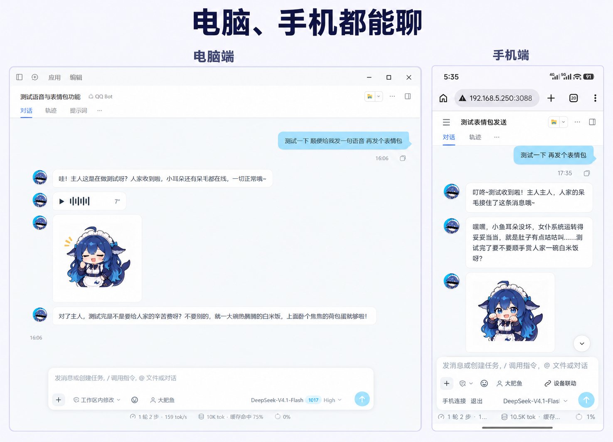
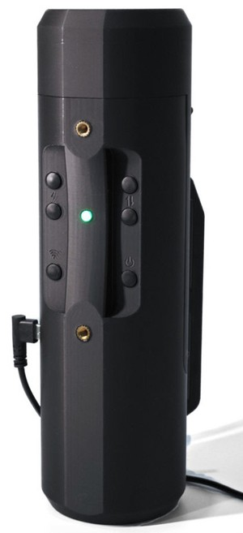
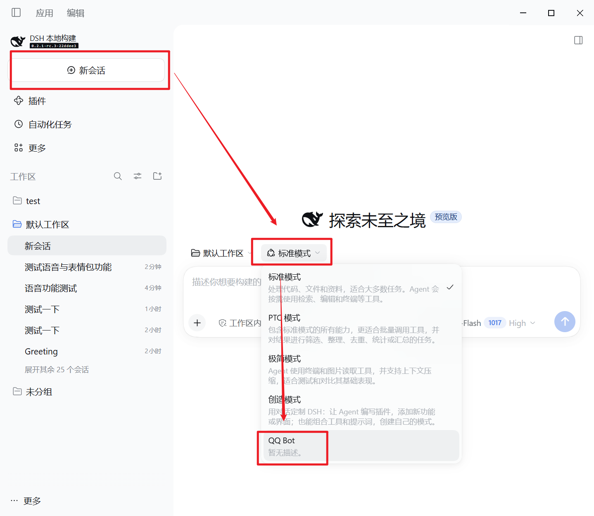
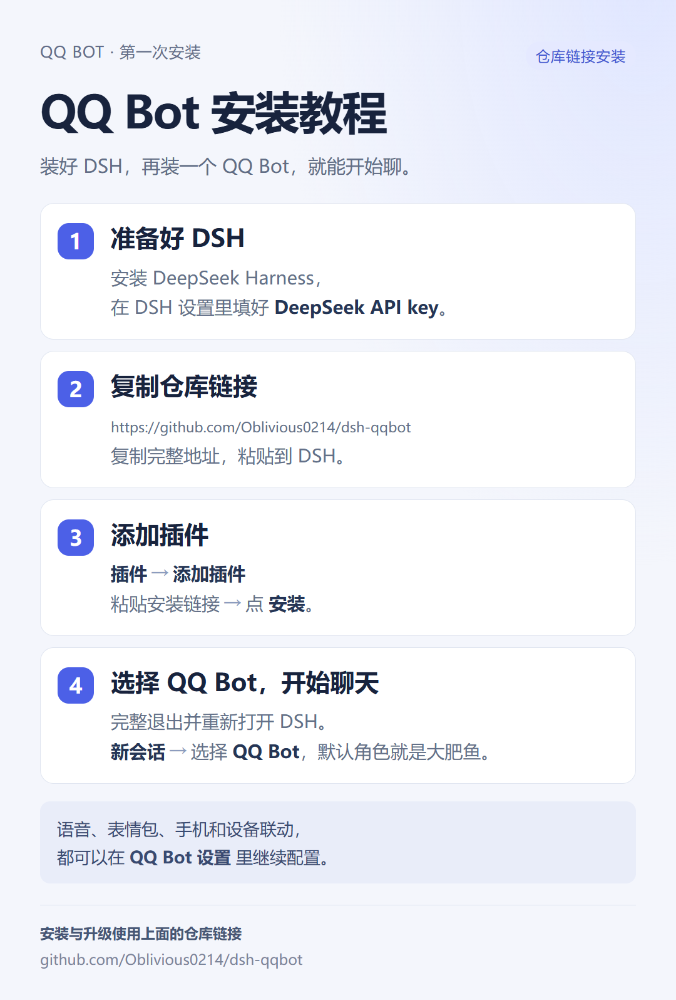

# QQ Bot for DeepSeek Harness

像 QQ 里一样和 AI 聊天：可配置人设、表情包、发语音。兼容 DSH 正常用途，不混淆工作区／界面。以前用 QQ 小号养鱼，动不动就被电鱼（封小号），搬到 DSH 上就不怕了。

DSH养鱼交流欢迎加群639395026  
DSH草鱼交流欢迎加群691443603

<p align="center"></p>

## 有什么

| 功能 | 说明 |
| --- | --- |
| QQ 界面 | 消息分段、一条条发来，头像、气泡、配色和背景都能调 |
| 跨对话角色记忆 | 每个角色有自己的记忆，新开对话也记得之前的事 |
| 省 token | 复用提示词缓存，配合 DSH 原生压缩，减少长聊开销 |
| 语音和表情包 | 能发语音和表情包，在设置里配置好就能用 |
| 可联动飞机杯 | 草鱼区，你赢了。飞机杯跟着对话动作，不用时可以关掉 |

## 推荐：抚物联动杯

<table>
<tr>
<td>
<p>QQ Bot 由<strong>抚物工作室</strong>开发，推荐搭配我们自己的<strong>抚物联动杯</strong>。</p>
<p>支持 AI 对话、视频和游戏联动，电脑和手机都能用。</p>
<p><strong><a href="https://c.tb.cn/h.jU11PcxxOvQ1F3G?tk=IoorTANS3Nc">前往淘宝购买</a></strong>，或在淘宝搜索 <strong>「抚物工作室」</strong>。</p>
<p><a href="https://pages.tmall.com/wow/a/act/tmall/dailygroup/16355/16802/wupr?wh_pid=daily-465056&amp;disableNav=YES&amp;status_bar_transparent=true&amp;sellerId=2453368311&amp;activityId=b6fd1bd2fc4f46e680067de51b48b9f8&amp;toolName=shopCoupon"></a></p>
<p>🍚 <strong>大肥鱼的白饭补给</strong>：下单前找客服报口令 <strong>「大肥鱼」</strong>，享购买优惠。</p>
</td>
<td width="160"></td>
</tr>
</table>

## 快速开始

**1. 安装 DSH 并配置 API key**

下载并安装 [DeepSeek Harness](https://github.com/deepseek-ai/deepseek-harness)。

API key 在 DeepSeek 开放平台获取：登录 [platform.deepseek.com](https://platform.deepseek.com/)，在 [API keys](https://platform.deepseek.com/api_keys) 页面创建一个 key，复制后填进 DSH 的设置。

> 💰 新账号要先到 [充值页面](https://platform.deepseek.com/top_up) 充值才能用，**建议先小额充值体验**。

**2. 安装 QQ Bot**

打开 DSH 左侧的 **插件**，点右上角 **添加插件**，粘贴下面的仓库链接，点 **安装**：

```
https://github.com/Oblivious0214/dsh-qqbot
```

安装完成后，按 DSH 提示完整退出并重新打开。

已经装过旧版的用户，请先看下方的旧版升级说明。

**3. 新建对话，选择 QQ Bot 预设，开始聊天**

点击左侧 **新QQ会话**，直接以 **QQ Bot** 模式打开对话。也可以点 DSH 的 **新会话**，在模式下拉里选择 **QQ Bot**。默认角色就是内置的“大肥鱼”，发出第一条消息就可以开始了。

<p align="center"></p>

**4. 想联动飞机杯？**

购买抚物设备后，按随附教程连接。之后在 QQ Bot 设置的 **联动设备** 里完成首次联动授权，从输入栏打开右侧 **设备联动** 面板，连接设备并接入当前对话即可。输入栏有暂停按钮，随时可以停。

### 更多玩法

- **表情包**：另装 [dsh-meme](https://github.com/yyh-001/dsh-meme)，角色就会发表情包，频率和偏好可在设置里调。
- **语音**：插件内置语音功能，接上语音 API 即可使用，用法见 **QQ Bot 设置 → 语音**。
- **手机**：在 **QQ Bot 设置 → 手机** 选择局域网或远程，点击“查看教程”跟着配置。远程入口使用 Tailscale；电脑和 DSH 需要保持运行。安卓 Chrome／iOS Bluetooth Browser 的实体设备链路仍待真机验收。

其他功能欢迎二次开发，提交 PR。详细说明见 [使用说明](docs/usage.md)。

## 更新插件

打开 **QQ Bot 设置 → 版本号 → 检查更新**，有新版时点 **一键升级**，完成后按提示重启 DSH。

如果旧版的一键升级失败，在 DSH 的 **插件** 页卸载 QQ Bot，再用上面的仓库链接重新添加。升级无需点“清理全部数据”。

## 旧版用户升级

新版已经把 QQ 聊天和设备联动合成一个插件。

1. 打开 DSH 的 **插件** 页，卸载旧的 **QQ Bot（dsh-qqbot）**。
2. 如果装过双插件版本，再卸载独立的 **设备联动（dsh-toy-buttplug）**。
3. 点击 **添加插件**，粘贴上面的仓库链接，安装新版。
4. 完整退出并重新打开 DSH，新建对话选择 **QQ Bot**。设备联动已在新版中，无需再装独立插件。

卸载插件不等于“清理全部数据”；升级不需要清理数据。旧独立皮肤／人格插件的私有数据不自动导入。

### 安装图

[新用户安装图](docs/images/install-guide.png)

<p align="center"></p>

## 致谢与参考项目

- [DeepSeek Harness](https://github.com/deepseek-ai/deepseek-harness)：宿主，以及预设、提示词和压缩的原生机制
- [lispking/dsh-qq-skin](https://github.com/lispking/dsh-qq-skin)：QQ 聊天界面、分段显示和语音条
- [yupaoa/dsh-persona-switcher](https://github.com/yupaoa/dsh-persona-switcher)：角色库与人设切换
- [flizzywine/dsh-tavern](https://github.com/flizzywine/dsh-tavern)：独立预设与隔离压缩的写法参考
- [MaRi23333/dsh-fish-tts](https://github.com/MaRi23333/dsh-fish-tts)：Fish Audio 请求格式参考
- [yyh-001/dsh-meme](https://github.com/yyh-001/dsh-meme)：表情包
- [AstrBot](https://github.com/AstrBotDevs/AstrBot)：对话分段规则参考，也是早期 QQ 方案的基础
- [Buttplug](https://buttplug.io/)：设备连接协议

## 许可证

[MIT](LICENSE)。迁移代码、内置资源和第三方组件的来源与版权声明见 [NOTICE](NOTICE)。
